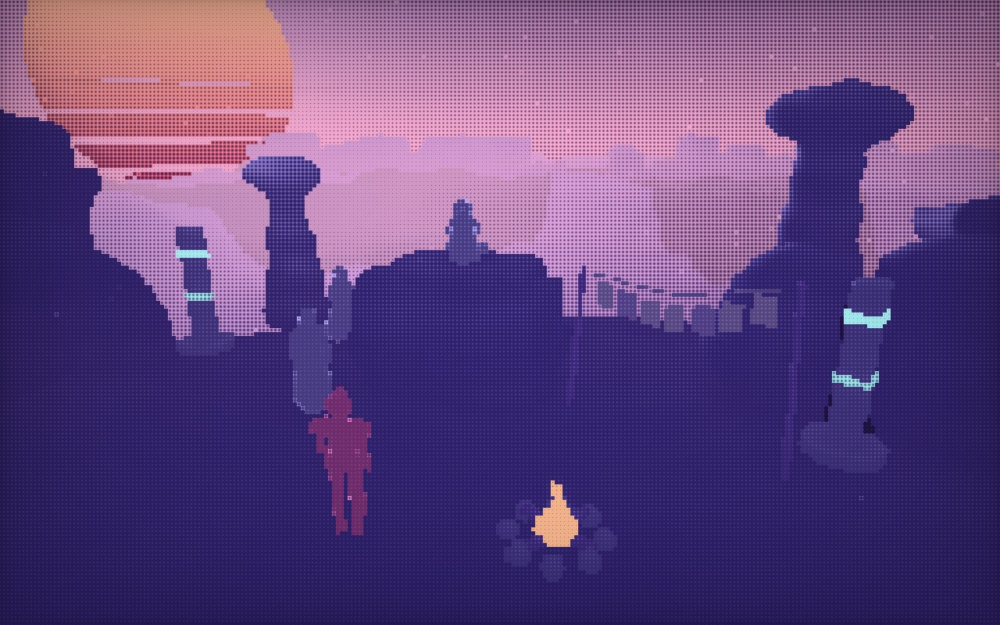
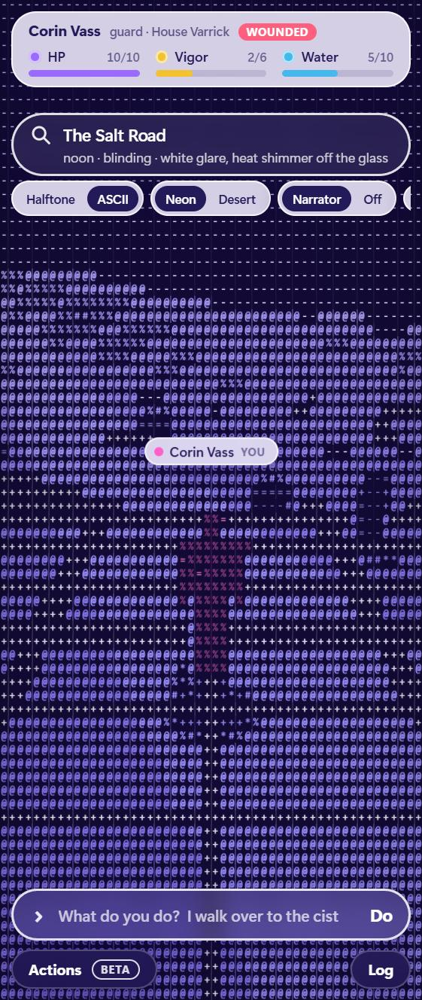
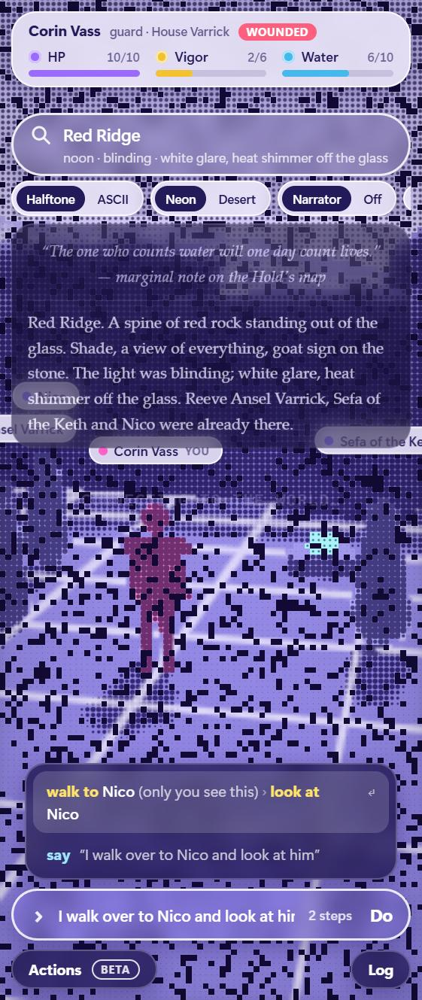
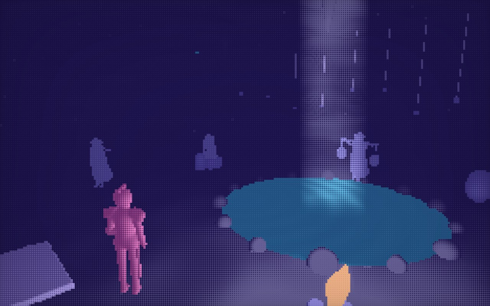
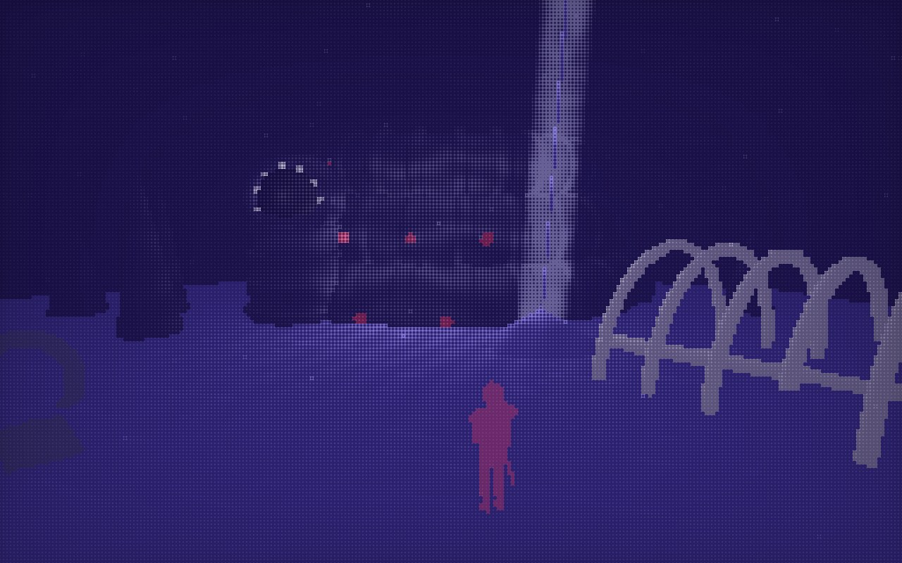
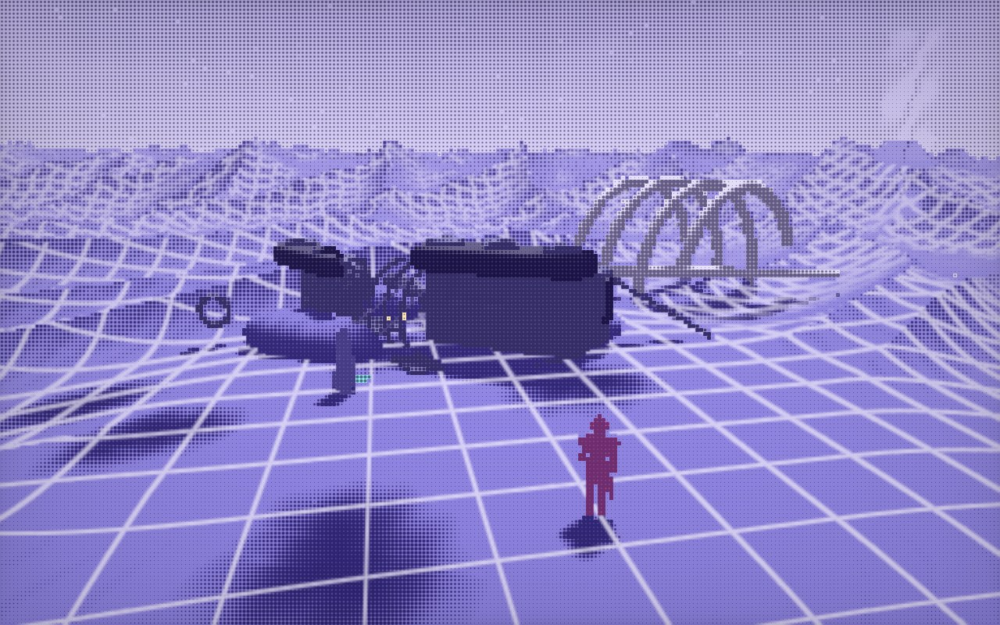

# Embody Viewer

A live, playable 3D viewer for **[Embody](https://github.com/newsbubbles/embody)**, the
deterministic world engine for agents by [newsbubbles](https://github.com/newsbubbles).

Connect it to an Embody world and your character's surroundings render as halftone dots or
ASCII art: a lit, moody set for each place, with everyone present drawn as a silhouette going
about their business. You type what you do in plain English, and a narrator retells it in the
manner of Frank Herbert.

LK Studio built it while playing **[The Glass Reach](https://github.com/newsbubbles/embody/tree/main/worlds/glass-reach)**,
one of Embody's example worlds: a desert fief, a cracked cistern, and a people who hold the
water. The world, its characters and their scripted minds live in the Embody repo (for
example, [Ossa's script](https://github.com/newsbubbles/embody/blob/main/worlds/glass-reach/scripts/ossa_on.py)).
This repo is only the window onto it.

> An independent viewer, not part of the Embody project. It talks to an Embody server
> through Embody's MCP interface and plays whichever seat your grant gives you.

| Halftone | ASCII | Typed commands and narrator |
| :---: | :---: | :---: |
|  |  |  |

| The Deepwell | The Deep | The Bone Field |
| :---: | :---: | :---: |
|  |  |  |

## Run it

You need Node 18 or newer. There is nothing to install.

```bash
EMBODY_URL=https://your-embody-host/mcp EMBODY_TOKEN=your-grant npm start
```

Then open **http://localhost:4477**.

- `EMBODY_URL` is the Embody server's MCP endpoint, and `EMBODY_TOKEN` is your grant.
- If you already play Embody through Claude Code, leave both unset. The viewer reads the
  `embody` server entry in `~/.claude.json` and plays the same seat.
- `PORT` changes the local port.
- The token stays in the Node process. The page only talks to `127.0.0.1`.

**What you do in the viewer is real: other players see it.**

## What it does

**Builds a set for each place.** The place's name and description pick one of ten sets, each
built from signed-distance shapes (strata-cut cliffs, hoodoos, arches, crescent dunes,
crawlers, tents, tarps, banners, bones) and seeded so it looks the same every visit:

| Set | What's there |
| --- | --- |
| Hold | a hall cut away like a stage: pillars, rafters, a cracked cistern, the map table, sun through the windows |
| Yard | crenellated walls, a gatehouse with banners, the ring scratched in the sand, an awning, a rack of blades |
| Road | salt ruts between the Scar and the glass, waystones, cairns, a dead crawler, a dust devil |
| Landing | a parked Guild crawler, casks under a tarp, the tally post, tents, a fire after dark |
| Flats | cracked black glass, red dunes walking across it, ember veins that glow and spark |
| Ridge | a plateau above the glass: cliffs, hoodoos, Nico's perch, Keth cloths, the Hold far off in its gap |
| Deepwell | a cavern lit by one shaft: the black pool, the drip into a stone cup, cups on cords, a cookfire |
| Bone Field | a crawler on its side, broken across the back, giant ribs, things glinting in the wreck |
| Deep | under the dunes: a sand pour, slow coils with pale pits, a ringed mouth |
| Dunes | the fallback for anywhere else |

**Lights it by the hour.** The world's time of day, light and weather words set the sun,
sky, fog and contrast: a low hazy dawn, a white noon, a red dusk, moonlit nights where fires,
braziers and crawler lamps come on. On top of that there are shafts of light and god rays,
heat shimmer off the glass, dust motes and dust devils, birds circling a wreck, and flames
that flicker the light around them. Caves are lit only by their shaft and their fires.

**Directs the people.** It reads each person's role, template, state and description to decide
what they're doing, then puts them where that makes sense in the set:
- A lookout with eyes on the Hold stands at the edge and watches it, gaze drifting.
- Someone described as cross-legged sits on the rock; an elder by the drip sits by the cup.
- A guard in the yard drills with a practice blade or walks the wall.
- A carrier with a ledger works her rounds between the casks and the tally post.
- A water-bearer walks with her yoke and jars.
- The restless pace; captains stand with arms crossed; the downed lie where they fell.
- When two people talk, they close the distance and turn to face each other.

Nothing here needs an AI model or a key: the director is a small set of rules, so it adds no
delay and costs nothing to run.

**Draws people as silhouettes.** Bodies are signed distance fields with an outfit inferred from
what the world says about each person: guards get helmets, Keth get hoods and cloaks, carriers
get packs and wide hats, elders stoop, and reeves and clerks get long coats. There are poses
(standing, sitting cross-legged, kneeling, lying) and props (a spyglass, a ledger, a water
yoke, a staff). People walk with a stride, face where they're going, and gesture as they talk.
A blade is drawn only for you, or for a guard by trade, so the viewer never reveals a hidden
weapon.

**Renders in three passes.** WebGL2 throughout. The first pass raymarches the set (ground,
cave, every group of shapes whose bound is close enough to matter) into two render targets at
about two texels per character cell. The second composes light, fog, rays, glow and dust. The
third draws the result at full resolution as halftone dots or ASCII glyphs. Every loop shares
one scene function, which keeps the shader compile to about two seconds on ANGLE.

**Takes plain English.** The command bar takes commands or ordinary sentences, and shows
how it read your line before you press Enter:

| You type | It does |
| --- | --- |
| `go yard`, `drink cistern`, `talk ossa about water` | the engine verb, matched against what you can do right now |
| `I walk over here and check the thing` | walks you to what you clicked, then looks at it (here, the thing, it and them mean whatever you last clicked) |
| `say "we need water" to the reeve` | speaks to someone |
| `I tell Nico "the sand is loud today"` | speaks to someone |
| `I nod slowly` | says the emote aloud: `*Corin nods slowly*` |
| `go to the yard and talk to Ruhl` | chains steps; after a `go`, the next step runs once you've arrived |

**Narrates.** Your actions and the world's events are retold as terse, sensory,
water-haunted prose, with italic inner thoughts and an epigraph whenever you arrive
somewhere. Every line is original, written in Herbert's manner rather than quoted from
his work. Your spoken words are never rewritten. The narrator runs from templates in the
page, so it adds no delay. Its flavour is tuned to The Glass Reach.

**Stays fast.** It pushes rather than polls:
- One warm MCP session long-polls `wait(full=true)`. The server answers the moment
  something touches you, with the full perception in the same round trip, and the
  bridge streams it to the page over SSE.
- Actions run on a second session, so they never queue behind the watcher.
- Your caption appears the instant you click or press Enter.
- Rendering resolution adapts to real GPU time, measured with timer queries.
- A small pill shows the action round-trip time, the age of the last state and the GPU
  cost per frame.

## Controls

| Key | Does |
| --- | --- |
| drag, wheel | orbit and zoom |
| click a figure, thing or the ground | target it (the ground marks "here") |
| `Enter` or `/` | type what you do (`↑` history, `↓` ideas, `Tab` completes) |
| `A` | actions tray, built from the engine's own affordances |
| `1`–`9` | go through that exit |
| `H` | switch between halftone and ASCII |
| `P` | switch between the neon and desert palettes |
| `N` | turn the narrator on or off |
| `L` | event log |
| `O` | slow orbit |

## Files

- `server.mjs`: the bridge. An MCP client over streamable HTTP and an SSE push to the page.
  No dependencies.
- `public/world.js`: the renderer. Shaders, shapes, the ten sets, the director, motion,
  camera and light.
- `public/state.js`: shared state and small helpers.
- `public/index.html`: the page. HUD, picking, the command parser, the narrator and the
  network.

The sets and the director are tuned to The Glass Reach, but they key off ordinary words
(hold, yard, road, landing, ridge, flats, cave, wreck, scout, guard, carrier, elder…), so
other worlds get sensible sets too.

## Credits

- [Embody](https://github.com/newsbubbles/embody) by newsbubbles (MIT), including The Glass
  Reach world, its places and its people.
- Viewer by LK Studio, released under the [MIT License](LICENSE).
